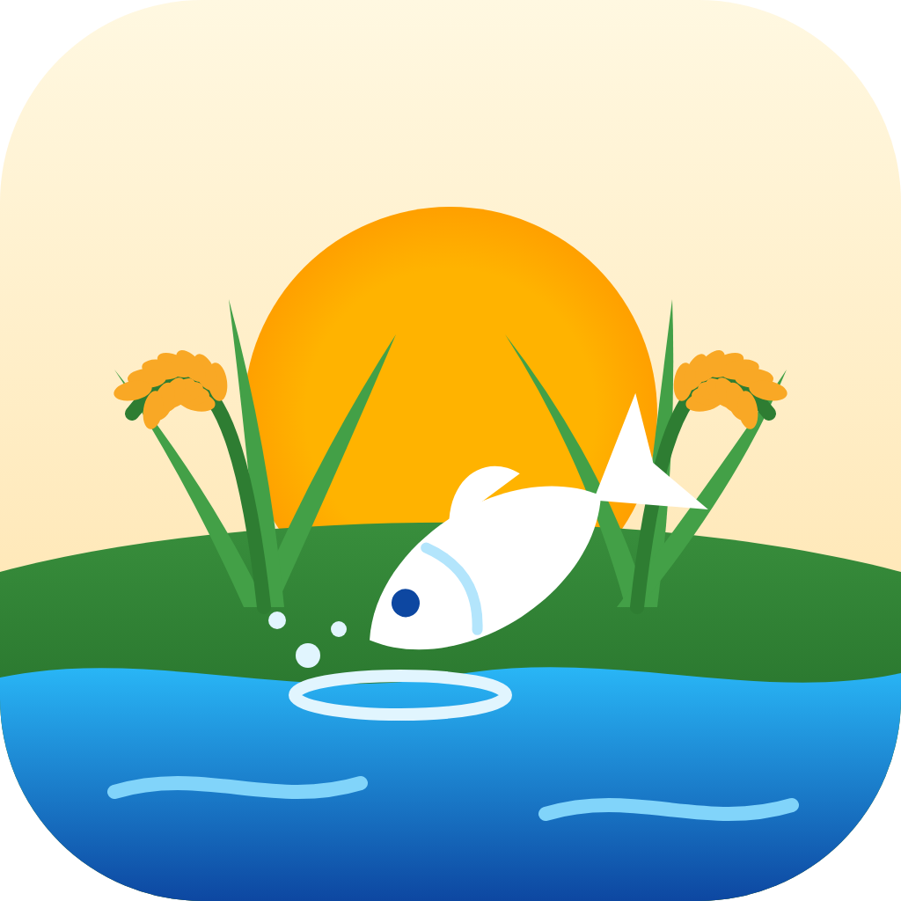

# চাষিবন্ধু — Chashibondhu
**চাষির পাশে, সব সময়**



## ইনস্টল (ফোনে)
1. ফোনে এই repo-র **Releases** খুলুন (সবার উপরেরটা *Latest*)।
2. `Chashibondhu-arm64-v8a.apk` নামান। কম দামি/পুরনো ফোনে ইনস্টল না হলে `Chashibondhu-armeabi-v7a.apk` নিন।
3. খুলুন → "অজানা অ্যাপ ইনস্টল" অনুমতি দিন → **ইনস্টল**।
4. পরের সংস্করণ পুরনোটার উপরেই ইনস্টল হয়, তথ্য মুছে যায় না।

## ইনস্টল (কম্পিউটারে, Windows ১০/১১)
একই Release থেকে `Chashibondhu-Windows-Setup.exe` নামিয়ে চালান (অ্যাডমিন লাগে না)। ইনস্টল ছাড়া চালাতে `Chashibondhu-Windows-portable.zip` আনজিপ করে `chashibondhu.exe` খুলুন।
ফোনের তথ্য কম্পিউটারে আনতে: ফোনে **সেটিংস → ব্যাকআপ ও এক্সেল ফাইল → ব্যাকআপ ফাইল বানান**, ফাইলটা কম্পিউটারে পাঠান, কম্পিউটারে **ফাইল থেকে আনুন**।

প্রতিটি সংস্করণ **Releases**-এ থেকে যায়। পরীক্ষার চেকলিস্ট: [TESTING_BN.md](TESTING_BN.md)

---

Offline-first Flutter app for small fish and crop farmers in Bangladesh. Bangla only, big buttons, no login. Version 0.3 — Android phone and Windows PC.

| Home card | What's inside |
|---|---|
| আমার পুকুর | Ponds, 30-second daily log, history, **mortality & feed charts**, disease reports for the pond |
| খাবার হিসাব | Feed calculator |
| পানি চেক | Water checker (green / yellow / red) |
| আবহাওয়া ও বাজার দর | **Weather** (Open-Meteo, 3 days, pond tip) · **Market prices** |
| রোগ চেক | **মাছের রোগ (পুকুরবন্ধু)** · **ফসলের রোগ** · past reports |
| ডায়েরি | **Reminders** · **Biosecurity checklist** · reports · pond records |

⚙ on Home opens **Settings**. The strip under the title is **আজকের কাজ** (smart alerts, below).

## Smart features (offline, rule-based)
`lib/features/smart/smart_rules.dart` reads the farmer's own records and lists what needs doing today:
missing daily logs · dead fish rising (last 3 days vs previous 3) or many dead · feeding >30% above the calculator ·
average weight not updated for 15+ days · harvest within 14 days · recent disease check with "বেশি" ·
weather risk from the saved forecast · low biosecurity score · due/overdue reminders (on PC these replace phone alerts).
Each item has a button that opens the right screen. Pure Dart, covered by `test/smart_backup_test.dart`.

## Phone ↔ PC without internet
Settings → **ব্যাকআপ ও এক্সেল ফাইল**: a JSON backup file (shared on phone, "save as" on PC) that another device imports
(merge: newer copy wins, nothing deleted, photos not included), and Excel-ready CSV (UTF-8 BOM) of pond logs and disease reports.

## PC (Windows) build
CI job `windows` runs `flutter create --platforms windows` + `tool/patch_windows.dart` (Bangla title, icon), builds,
bundles the VC++ runtime, runs a `--selftest` smoke test, then makes an Inno Setup installer and a portable zip.
On wide windows the app keeps its phone layout in a centered 720 px column.

- Bangla testing checklist + APK steps: **[TESTING_BN.md](TESTING_BN.md)**
- Database: [supabase/schema.sql](supabase/schema.sql)

## Build & run

**GitHub Actions builds every push to `main`** (`.github/workflows/build.yml`, Flutter pinned) and publishes a Release with the APKs. Optional Supabase keys go in repo **Settings → Secrets → Actions** as `SUPABASE_URL` and `SUPABASE_ANON_KEY`.

Local build needs Flutter 3.27 and Android Studio.

```bash
bash tool/setup_android.sh      # one time: flutter create + patch android/ + pub get
flutter test
flutter run
flutter build apk --release --split-per-abi          # offline-only build
# with optional cloud backup:
flutter build apk --release --split-per-abi \
  --dart-define=SUPABASE_URL=https://xxxx.supabase.co \
  --dart-define=SUPABASE_ANON_KEY=eyJ...
```

`tool/patch_android.dart` (also runs on Windows: `dart run tool/patch_android.dart`) sets:
- the Bangla app name
- the INTERNET, notification and boot permissions
- **minSdk 26 (Android 8+)**
- core-library desugaring
- the reminder receivers
- a `tel:` query
- R8 keep rules for the reminders plugin

It works on both Groovy and Kotlin-DSL Gradle files and is safe to re-run.

**Size:** no heavy packages (charts are hand-drawn, no chart library). The bundled Bangla font is about 280 KB. Expect each split APK to be around 20 MB, well under the 40 MB target. Check with `ls -lh build/app/outputs/flutter-apk/`.

## Structure

```
lib/
  core/
    data/bd_districts.dart        64 districts + coordinates
    notifications/                local reminders (Asia/Dhaka)
    storage/                      Hive boxes, AppSettings
    sync/                         outbox, Supabase SyncManager, table mappers
    utils/                        Bangla digits/dates, photos, phone call, ids
    widgets/                      BigButton, ChoiceGrid, MultiChoiceGrid, HubScreen,
                                  SimpleBarChart, SignalBanner, DisclaimerBox …
  features/
    home/          6-card registry (home_features.dart)
    pond/          diary + charts + reports section
    feed/  water/
    disease/
      common/      JSON library loader, matcher, report model/repo,
                   photo → symptoms → result screens (shared by fish & crop)
      fish/        PukurBondhu start (pick pond)
      crop/        crop start (pick crop)
    weather/  market/  biosecurity/  reminders/  settings/
assets/
  data/fish_diseases.json   15 fish problems, 10 symptoms
  data/crop_diseases.json   12 crop problems, 9 symptoms, 7 crops
  data/market_prices.json   sample prices (flagged as sample)
  fonts/                    Noto Sans Bengali (OFL)
```

## How the disease check decides
`DiseaseMatcher` scores each problem from the ticked symptoms. The score is `0.65 × coverage + 0.35 × precision`, using the symptom weights in the JSON.
- It shows the top 3 problems.
- **Only the first one can be "বেশি"**, and only if it clearly leads the second. A tie stays "মাঝারি". There is never a percentage or "sure".
- Every result screen shows the Bangla disclaimer.
- Fish advice is general management only: water change, lime, salt, aeration, separating sick fish, less feed.
- Crop results always add "অনুমোদিত ওষুধ লেবেল অনুযায়ী ব্যবহার করুন, আর কৃষি অফিসারের পরামর্শ নিন।"
- A unit test fails if a dose unit or a medicine name gets into the libraries.
- The photo is saved with the report for the officer. The app does **not** analyse the photo.

To add or tune problems, edit the JSON only.

## Optional cloud sync (Supabase)
1. Create a project. Run `supabase/schema.sql` in the SQL editor. It creates the tables, row-level security and the private `report-photos` bucket.
2. Enable **Authentication → Anonymous sign-ins**. The app signs in silently and never shows a login. Later, a phone number can be linked to the same user for the optional phone profile.
3. Build with the two `--dart-define` values above. Without them, the app is offline-only and Settings says so.

**How it works:**
- Every save goes to Hive first, plus an entry in a local outbox.
- `SyncManager` pushes the outbox on app start, on resume, every 10 minutes and 5 seconds after a change.
- With no internet it just waits. Parent tables go before children.
- Report photos upload once.
- Market prices are **pulled** from `market_prices`. An admin adds rows in the dashboard (see the example at the end of the SQL file).
- Restoring data onto a new phone (pull) is not built yet.

## Notes before field release
- **Feed rates, water limits and all disease advice:**
  - Have a DoF / DAE officer review them.
  - Each lives in one place: `FeedCalculator`, `WaterLimits`, the JSON files.
- **Market prices:**
  - The bundled ones are **samples**, shown with a yellow "নমুনা দর" warning until real prices come from Supabase.
  - No scraping. A licensed price API can be added as another `MarketPriceSource`.
- **Location and weather:**
  - Location is chosen by district (64, with coordinates).
  - Upazila is an optional typed name. A full upazila list with coordinates can be added later.
  - The storm signal is from Open-Meteo wind gusts and thunderstorm codes, **not** the official BMD signal. The screen says to follow radio/TV.
- **Symptom list:**
  - The crop checklist has one extra symptom, "পাতায় সাদা গুঁড়া". Without it, powdery mildew cannot be told apart.
  - "Argulosis" and "fish lice" are split into body lice (Argulus) and gill lice (Ergasilus).
- **Reminders:**
  - Reminders use inexact alarms (no special permission). They can arrive a few minutes late.
  - The time zone is fixed to Asia/Dhaka.
- **Helpline:** the helpline is কৃষি কল সেন্টার 16123. Confirm the number is still current before release.
